## TaskFlow API - Module 4 Deployment

### Live Application URL
https://sctp-aie-backend-production.up.railway.app/api/tasks

### Railway Dashboard
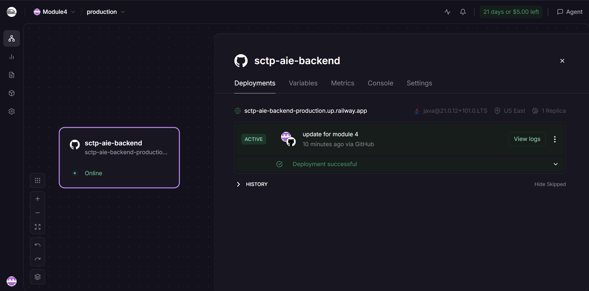

### Live URL
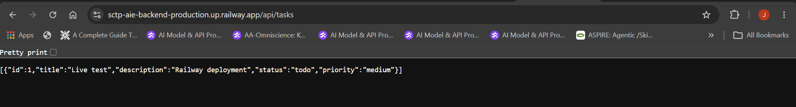

### Notes
- Built with Docker multi-stage build (Maven build stage + Alpine JRE runtime stage)
- OPENAI_API_KEY set as a Railway environment variable (not committed to code)


# TaskFlow API - Module 3 Assignment

**Task management API**

---

## Requirements

* Java: 21
* Framework: Spring Boot (Maven)
* Dependencies: Spring Web, Lombok, Spring Boot DevTools, Spring AI (OpenAI), OpenAI API key

---

## Project Structure
```text
src/main/java/sg/edu/ntu/taskflow_api/
├── controller/   # Endpoint
├── model/        # Task entity
├── repository/   # In-memory data and CRUD
└── service/      # business logic layer
```
* Endpoints: http://localhost:8080/api/tasks

---

## Postman Test Screenshots
### Create Task
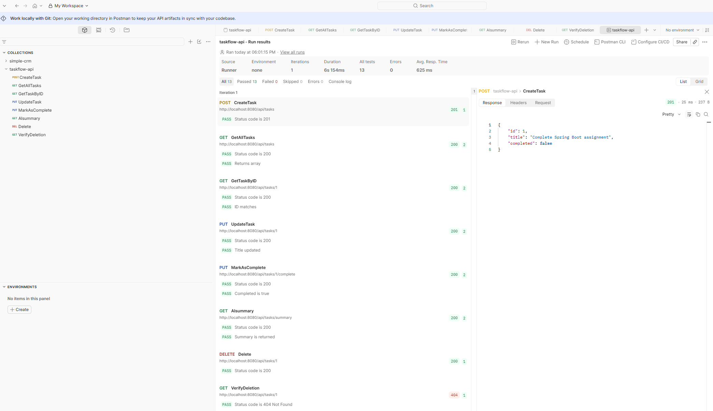
### Get All Tasks
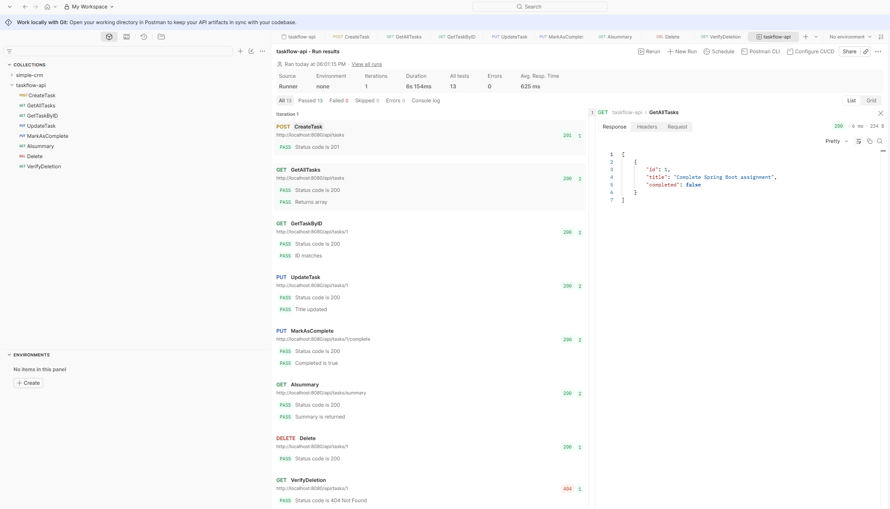
### Get Task By ID
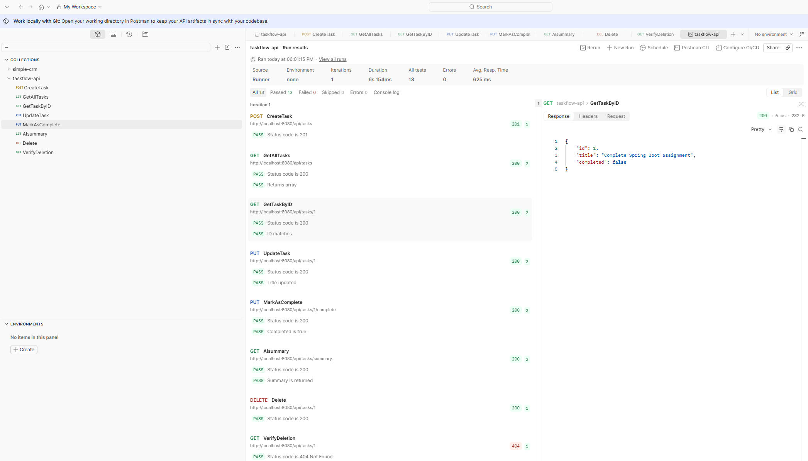
### UpdateTask By ID
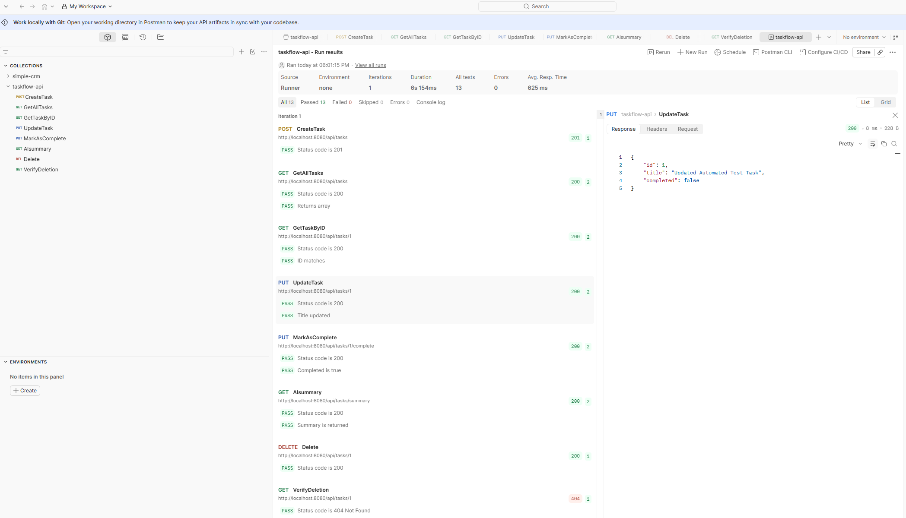
### Mark As Complete By ID
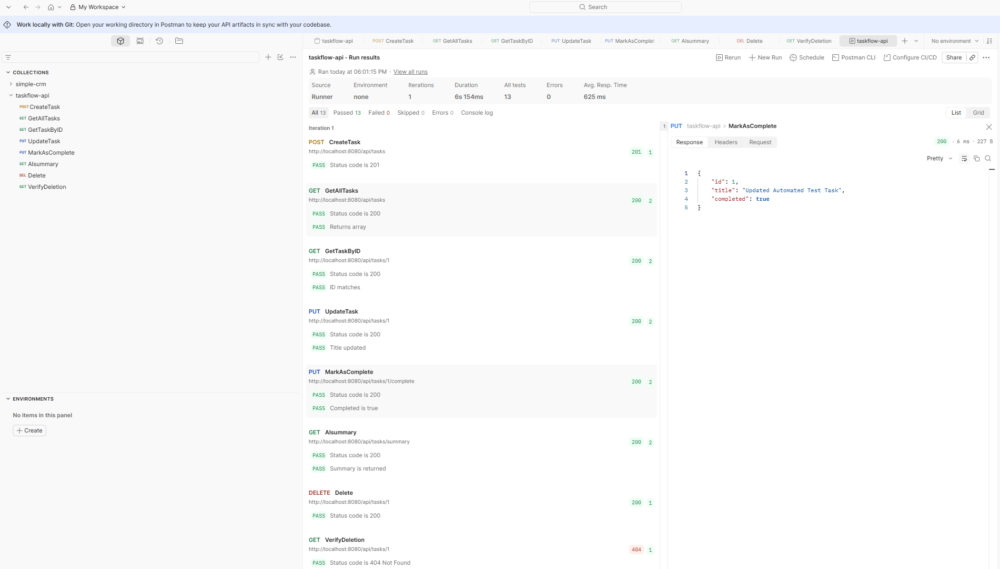
### Tasks AI Summary
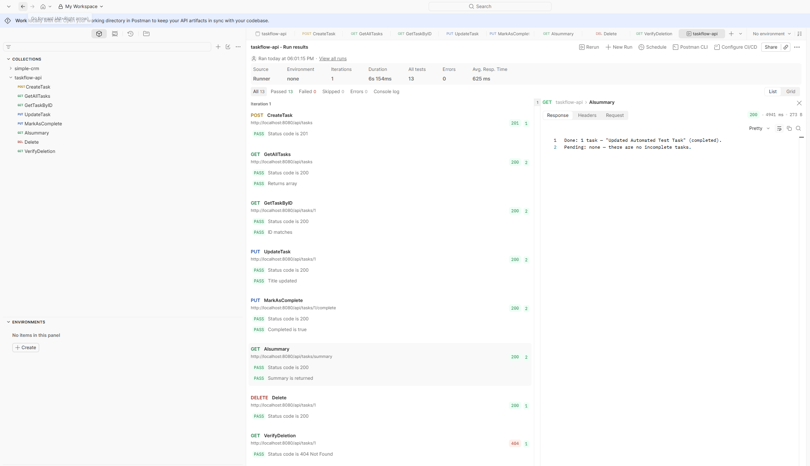
### Delete Task By ID
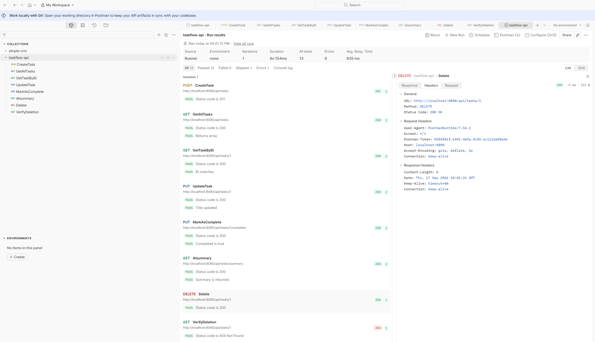
### Verify Delete Task By ID
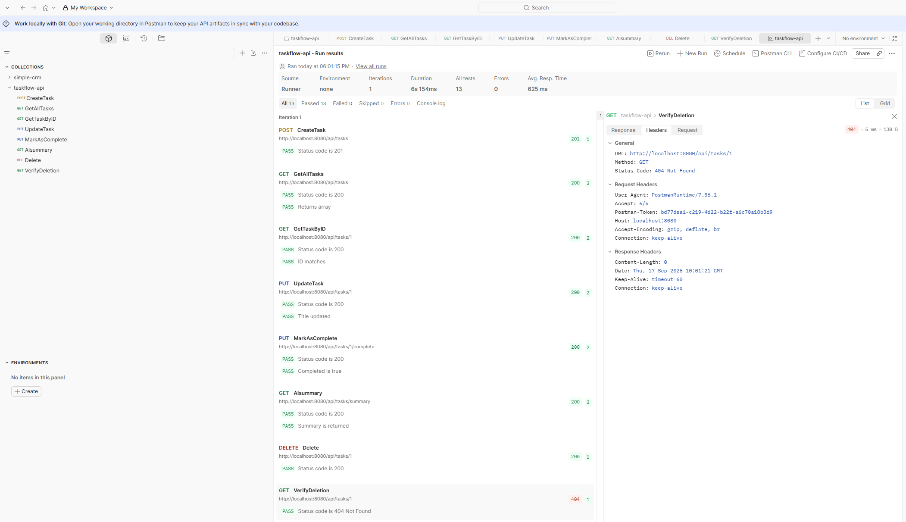
## Mark as complete or Delete by Selection
### Tasks List
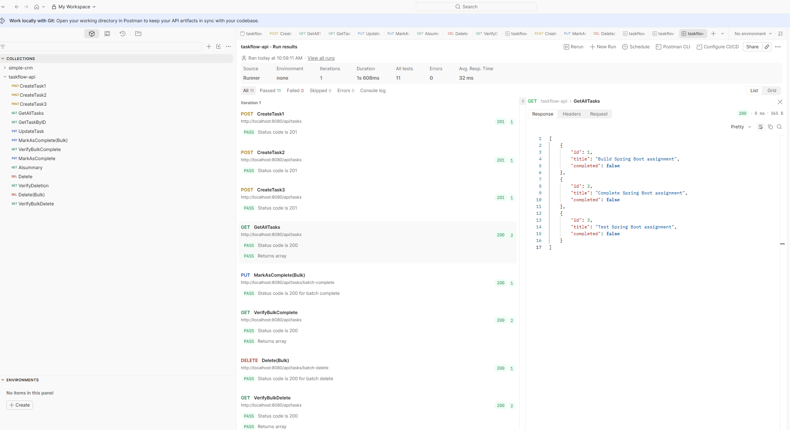
### Tasks Mark As Complete
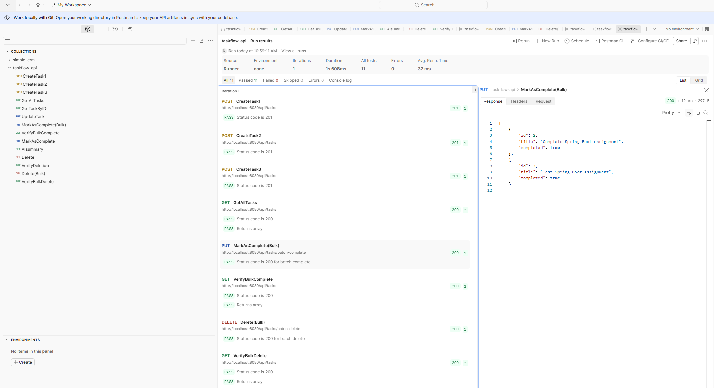
### Updated Tasks List
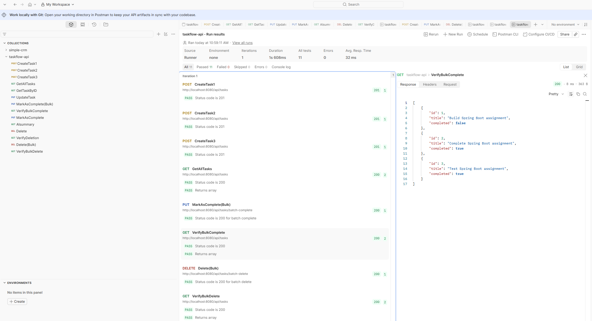
### Tasks Delete
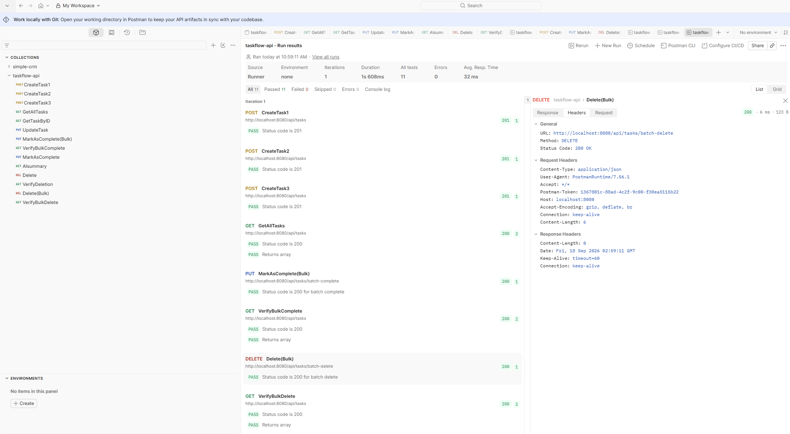
### Final Tasks List
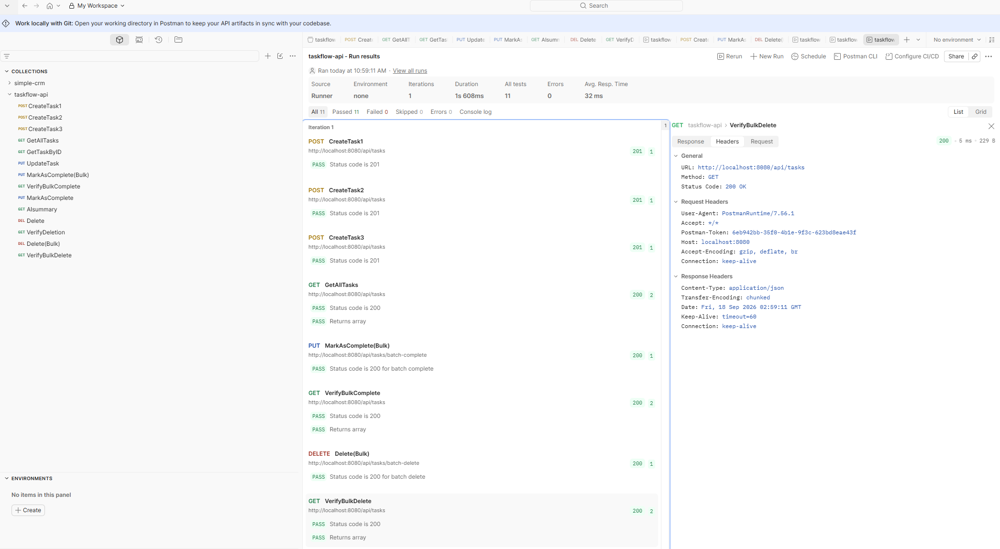

